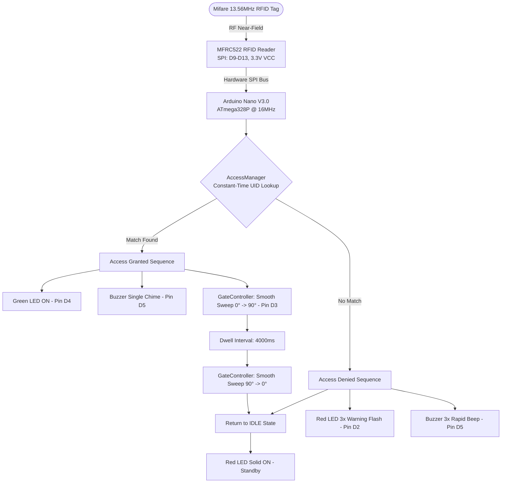

# 🚧 RFID-Controlled Wooden Barrier Gate System (Arduino)

[-00979D.svg?logo=arduino&logoColor=white)](https://www.arduino.cc/)
[](https://www.arduino.cc/)
[-blue.svg)]()
[]()
[](https://en.wikipedia.org/wiki/C%2B%2B)
[](LICENSE)
[]()

A production-ready **Arduino** automated boom barrier gate and access control system for parking lots, gated estates, and security checkpoints. Powered by an **Arduino Nano (ATmega328P)**, this system validates 13.56 MHz Mifare Classic RFID cards/fobs via SPI communication with the **MFRC522** reader, provides acoustic-visual status feedback, and smoothly actuates a wooden barrier arm using a metal-gear **TowerPro MG90S** micro servo with angular interpolation.

---

## 🏗️ System Architecture & Workflow



---

## 🛠️ Hardware Requirements & Bill of Materials (BOM)

### Complete Pricing in Nigerian Naira (₦ NGN) & USD ($)

| Item | Component | Specification | Role | Qty | Cost (₦ NGN) | Cost ($ USD) |
| :--- | :--- | :--- | :--- | :--- | :--- | :--- |
| **1** | **Arduino Nano V3.0** | ATmega328P, 5V, 16MHz (CH340/Type-C or Mini-B) | Main Controller Logic | 1 | ₦7,000 – ₦10,000 | $4.50 – $6.50 |
| **2** | **RC522 RFID Kit** | 13.56 MHz SPI module (includes 1 card + 1 blue fob) | Contactless Reader | 1 | ₦7,500 – ₦12,500 | $5.00 – $8.00 |
| **3** | **Extra RFID Cards/Fobs** | Mifare Classic 1K (13.56 MHz) | Additional User Tags | 2 | ₦2,000 – ₦3,000 | $1.50 – $2.00 |
| **4** | **Micro Servo Motor** | **TowerPro MG90S** (Metal Gear, 2.2 kg·cm) | Barrier Arm Actuator | 1 | ₦3,800 – ₦7,500 | $2.50 – $5.00 |
| **5** | **Active Piezo Buzzer** | 5V DC, continuous ~2.3 kHz tone | Audio Feedback Chime | 1 | ₦800 – ₦1,500 | $0.50 – $1.00 |
| **6** | **Status LEDs** | 1× Green (5mm), 1× Red (5mm) | Visual Access Indicator | 2 | ₦300 – ₦600 | $0.20 – $0.40 |
| **7** | **Current Limiting Resistors** | 220 Ω or 330 Ω (1/4W, 5% carbon film) | LED Protection | 2 | ₦200 – ₦400 | $0.15 – $0.25 |
| **8** | **Buffer Capacitor** | 220 µF to 470 µF (16V–25V electrolytic) | Inrush Current Buffer | 1 | ₦300 – ₦600 | $0.20 – $0.40 |
| **9** | **External 5V Power Supply** | 5V DC 2A regulated adapter or battery pack | System & Motor Power | 1 | ₦5,000 – ₦8,000 | $3.50 – $5.50 |
| **10** | **DC Barrel Jack Adapter** | Female 2.1mm × 5.5mm screw-terminal adapter | Power Jack Breakout | 1 | ₦1,000 – ₦1,800 | $0.70 – $1.20 |
| **11** | **Solderless Breadboard** | 400 tie-point half-size breadboard | Prototyping Platform | 1 | ₦3,500 – ₦5,500 | $2.50 – $3.80 |
| **12** | **Dupont Jumper Wires** | 20cm Male-to-Male & Female-to-Male | Interconnects | 20 pcs | ₦2,500 – ₦4,000 | $1.80 – $2.70 |
| **13** | **Wooden Barrier Arm** | Balsa or craft wood strip (15–20 cm × 1 cm × 2 mm) | Physical Barrier Arm | 1 | ₦1,500 – ₦3,000 | $1.00 – $2.00 |
| **14** | **Support Stand / Pillar** | Wood block, PVC offcut, or 3D-printed pillar | Vertical Servo Mount | 1 | ₦1,500 – ₦3,000 | $1.00 – $2.00 |
| **15** | **Fasteners & Adhesives** | M2 servo horn screws, wood screws / hot glue | Mechanical Mount | 1 set | ₦1,500 – ₦2,500 | $1.00 – $1.80 |

**Investment Summary:**
- **Core Electronics & Wiring (Items 1–12):** `₦35,900 – ₦58,900` (~$24 – $38 USD)
- **Complete Assembly with Mechanical Frame (Items 1–15):** `₦40,400 – ₦67,400` (~$27 – $44 USD)

---

## ⚡ Engineering Rationale: MG90S vs. SG90 & Single 5V Power

### 1. Actuator Choice: Why the MG90S?
- **Rotational Leverage:** A 15–20 cm wooden arm creates rotational torque at the pivot point. The **MG90S** provides **2.2 kg·cm** stall torque vs. the SG90's 1.5–1.8 kg·cm.
- **Stripped Gear Prevention:** The SG90 uses nylon teeth that strip if someone bumps the gate. The MG90S utilizes solid **brass/metal gears**.
- **Minimal Price Difference:** In local Nigerian markets, the MG90S costs only ₦1,500 – ₦2,500 more than an SG90.

### 2. Single 5V 2A Power Source with Inrush Filtering
A single **5V 2A** supply is optimal:
- **Nano + RC522 + LEDs:** ~70 mA – 100 mA
- **MG90S Moving:** ~250 mA – 400 mA
- **MG90S Peak Surge:** ~800 mA – 1.0 A
- **Total Peak Consumption:** ~1.1 A (well within the 2.0A limit).

> ⚠️ **CRITICAL WIRING RULES:**
> 1. **Parallel Rails:** Wire the external 5V positive wire directly to both the Arduino `5V` pin and the Servo `VCC` in parallel. **NEVER** power the servo motor through the Arduino's 5V onboard pin!
> 2. **Electrolytic Buffer:** Place a **470 µF electrolytic capacitor** directly across the servo's `+5V` and `GND` lines on the breadboard to eliminate voltage dips.
> 3. **Common Ground:** Arduino GND, RC522 GND, Servo GND, and Power Supply negative line must share a unified ground bus.

---

## 🔌 Circuit Pinout & Wiring Table

| Module Pin | Arduino Nano Pin | Voltage / Signal | Notes |
| :--- | :--- | :--- | :--- |
| **RC522 VCC** | **3.3V Pin** | +3.3V DC | ⚠️ **DO NOT connect to 5V! 5V will burn the RC522!** |
| **RC522 RST** | **Digital Pin 9** | Logic Reset | Controlled via software reset |
| **RC522 GND** | **GND** | 0V Ground | Common ground |
| **RC522 MISO** | **Digital Pin 12** | SPI MISO | Hardware SPI Bus |
| **RC522 MOSI** | **Digital Pin 11** | SPI MOSI | Hardware SPI Bus |
| **RC522 SCK** | **Digital Pin 13** | SPI Clock | Hardware SPI Bus |
| **RC522 SDA / SS** | **Digital Pin 10** | SPI Slave Select | Active LOW chip select |
| **MG90S PWM (Orange)** | **Digital Pin 3** | 50Hz PWM Signal | Angle command ($0^\circ - 90^\circ$) |
| **MG90S VCC (Red)** | **External 5V Rail** | +5V Regulated (2A) | Buffered with 470µF capacitor |
| **MG90S GND (Brown)** | **GND** | 0V Ground | Connected to common ground |
| **Red LED Anode (+)** | **Digital Pin 2** | Logic Output (via 220Ω) | Standby / Access Denied |
| **Green LED Anode (+)** | **Digital Pin 4** | Logic Output (via 220Ω) | Access Granted |
| **Active Buzzer (+)** | **Digital Pin 5** | Logic Output | Chime / Rejection alarm |

---

## 📁 Repository Structure

```
arduino-rfid-barrier-gate/
├── rfid_barrier_gate/
│   ├── rfid_barrier_gate.ino  # Main native Arduino sketch
│   ├── Config.h               # Pin assignments & authorized UIDs
│   ├── AccessManager.h        # UID authentication header
│   ├── AccessManager.cpp      # UID comparison logic
│   ├── FeedbackManager.h      # Status LED & acoustic tone header
│   ├── FeedbackManager.cpp    # Audio-visual indicators
│   ├── GateController.h       # Stepped servo motion header
│   └── GateController.cpp     # Smooth motion interpolation
├── platformio.ini             # PlatformIO build configuration
├── .gitignore                 # Binary and IDE ignore rules
├── LICENSE                    # MIT Open Source License
└── README.md                  # Complete engineering documentation
```

---

## 🚀 How to Run (Arduino IDE)

1. Launch the **Arduino IDE**.
2. Go to **Sketch > Include Library > Manage Libraries...** and install:
   - `MFRC522` by GithubCommunity / Miguel Balboa
   - `Servo` by Arduino (built-in)
3. Open [`rfid_barrier_gate/rfid_barrier_gate.ino`](rfid_barrier_gate/rfid_barrier_gate.ino).
4. Connect your Arduino Nano via USB.
5. In **Tools > Board**, select **Arduino Nano**.
6. In **Tools > Processor**, select **ATmega328P** (or *ATmega328P (Old Bootloader)* for clone Nano boards).
7. Select your USB serial port and click **Upload** (`Ctrl+U`).

### Enrolling Your Physical Card:
1. Open the Serial Monitor at **9600 baud**.
2. Tap your RFID card or keyfob against the RC522 scanner.
3. The Serial Monitor will print:
   ```
   Scanned UID: 4A:2F:81:B3
   >> ACCESS DENIED: Unauthorized Tag!
   ```
4. Copy the scanned 4-byte hex value into `rfid_barrier_gate/Config.h`:
   ```cpp
   const uint8_t AUTHORIZED_UIDS[][UID_LENGTH] = {
       {0x4A, 0x2F, 0x81, 0xB3}, // Your card!
       {0xDE, 0xAD, 0xBE, 0xEF}
   };
   ```
5. Re-upload the sketch. Scanning your card will now trigger **ACCESS GRANTED**, lifting the wooden barrier arm smoothly!

---

## 📜 License

Open source under the [MIT License](LICENSE).
